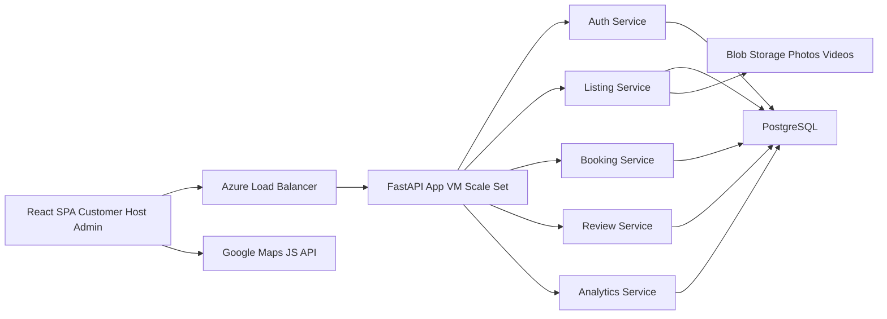
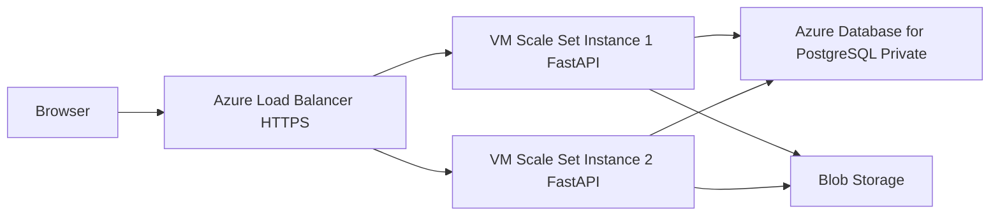

# Architecture — Component & Deployment (Week 1)

## Component diagram

## Deployment diagram

Scale rule (Sprint 3): min 2 instances, scale out on CPU over 70 percent,
max capped for cost. No session state on VMs (JWT). AWS mapping if asked:
VM Scale Set = EC2 Auto Scaling Group, Load Balancer = ALB,
Azure DB for PostgreSQL = RDS, Blob = S3.
